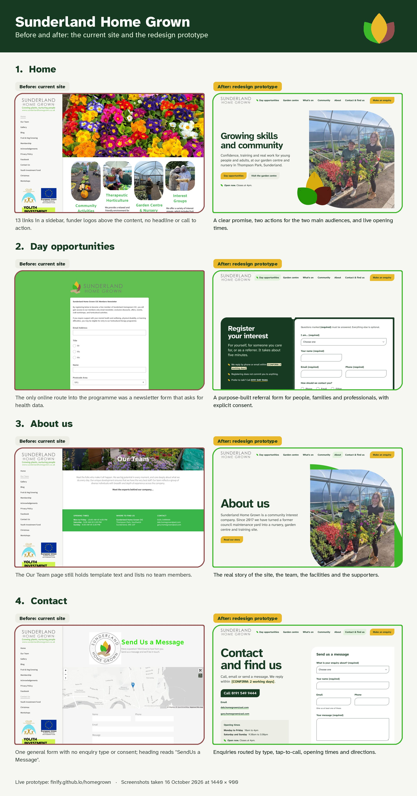

# Sunderland Home Grown: website redesign prototype

A clickable, responsive **visual proposal** for redesigning [sunderlandhomegrown.co.uk](https://www.sunderlandhomegrown.co.uk/), prepared for the University of Sunderland Changemaker internship (Digital & Web Development Assistant).

**Live prototype:** https://finify.github.io/homegrown/



Full-resolution version: [`docs/before-after.png`](docs/before-after.png). Each pair is also available as its own image: [Home](docs/before-after-1-home.png), [Day opportunities](docs/before-after-2-day-opportunities.png), [About us](docs/before-after-3-about-us.png), [Contact](docs/before-after-4-contact.png) (`.jpg` versions alongside).

> This is not the production site. The real site stays on 123-reg Website Builder (Duda), with the Ecwid store. Every section below maps to a standard builder widget, so the design can be rebuilt there without custom code. Forms validate in the browser but **send nothing**.
>
> Anything highlighted as **[CONFIRM: …]** is a fact we don't have yet. Nothing has been invented: prices, session days, staff names and capacity all need confirming with Home Grown staff.

## Pages

| File | Page | Main job |
|---|---|---|
| `index.html` | Home | Route each audience; lead to day opportunities |
| `day-opportunities.html` | Day opportunities hub | **Primary conversion:** register interest or make a referral |
| `garden-centre.html` | Garden centre | Visits, opening times, trade and wholesale enquiries |
| `whats-on.html` | What's on | Workshops (book via Ecwid) and regular groups |
| `community.html` | Community | Fruit & veg group, interest groups, volunteering, Hire us, free membership |
| `about.html` | About | Story, team, site and facilities, gallery, supporters |
| `contact.html` | Contact & find us | Routed enquiry form, map, getting here |
| `privacy.html` | Privacy & accessibility | Shows structure only; the wording needs review by SHG |

## Design idea

**The roundel's three leaves are the design system.** The Home Grown logo shows three leaves (green, gold and berry) held in a hand. That one shape does every job a generic rounded rectangle would normally do:

- **Photo frames:** photographs are masked into leaf shapes (two opposite corners rounded, two sharp).
- **Buttons, tiles and cards:** all use the same leaf corner (`rounded-leaf`).
- **Bullets:** small leaf shapes, and the "open now" indicator.
- **3D:** on the home page (three.js), the three leaves unfurl on load, follow the pointer and turn as you scroll. In "How to join" (on Home and Day opportunities), a seed in a pot grows one leaf per step as you scroll. By step four it carries the full roundel.
- **Colour:** sampled from the logo. Leaf green, gold and berry are used as whole fields of colour, on a pale "polytunnel white" ground with deep forest-green text.

**The live element** is the *Open now* indicator. It works out whether the garden centre is open right now in UK time, and when it next opens or closes.

### Motion (GSAP ScrollTrigger and three.js)
- Hero: the 3D roundel leaves unfurl, then turn and lift as the hero scrolls away. The hero photo slowly crossfades.
- "What a day here looks like": a pinned section that scrolls sideways on desktop, and a swipeable strip on phones.
- "How to join": a sticky 3D plant grows as you scroll through the four steps.
- Section parts rise in sequence as they enter; photos drift with parallax.
- **All motion switches off under `prefers-reduced-motion`** (the plant shows fully grown). The 3D only renders while on screen and falls back to a flat SVG if WebGL isn't available.

## Performance

Measured on the live site under simulated slow 4G, a 4× slower CPU and a phone-sized screen (`scripts/perf.mjs`):

| | Before | After |
|---|---|---|
| Home, first visit: main content visible (LCP) | 10.2 s | 1.1–1.4 s |
| Home, first visit: data downloaded | 1,655 KB | 430 KB |
| Clicking to another page: content visible | 0.7–1.6 s | 0.2–0.4 s |
| Data downloaded per page change | 150–1,650 KB | 0 KB (already prefetched or cached) |

How:
- **Prerendered HTML.** Each page's HTML is rendered at build time (Vue SSR), so content shows before any JavaScript runs. Vue then hydrates it.
- **Responsive AVIF/WebP photos** (400, 800 and 1200px wide) through the `<Pic>` component, instead of 200–350 KB JPEGs. Source photos live in `photos/`; run `npm run images` after adding one.
- **three.js loads last:** only after the page has loaded, when the browser is idle and the scene is near the screen. It's skipped entirely in data-saver mode.
- **Self-hosted, preloaded font:** one 34 KB variable file.
- **Instant page changes:** Speculation Rules prefetch internal pages and prerender a page when its link is hovered (Chrome and Edge). Other browsers prefetch on hover or touch. Pages cross-fade with view transitions.
- **A service worker** keeps scripts, photos and fonts cached between visits, because GitHub Pages limits browser caching to 10 minutes. Pages are always fetched fresh first, so new deploys show straight away.

## Accessibility (WCAG 2.2 AA target)
- Atkinson Hyperlegible Next at an 18px base with line height 1.6. Plain English, UK spelling.
- Every text and background pair is contrast-checked (figures in `tailwind.config.js`). White text is never set on leaf green or gold.
- Tap targets are at least 44px. Focus states are visible (forest outline, or gold on dark backgrounds). There's a skip link and one `h1` per page.
- An **Easy Read** tab on Day opportunities uses short sentences, one idea each, with a photo.
- Forms have real labels, an error summary that takes focus, and inline errors linked by `aria-describedby`. They are not colour-only, and consent is explicit.
- Tabs follow the ARIA tabs pattern (arrow keys, Home and End) and support deep links (`#for-you`, `#families`, `#professionals`).
- The FAQs use native `<details>`, so they work without JavaScript.

### Checks run
- **Playwright** (from the Notion list's testing step): 101 checks pass. They cover axe-core WCAG 2.2 AA on every page, no horizontal overflow at 375, 768 and 1440px, tap targets, no console errors, one h1, alt text, and interaction tests. The interaction tests are: referral form empty, invalid and valid submits; conditional organisation field; tabs and keyboard; deep links; contact `?type=` preselect; What's On filter; newsletter; and the mobile menu (Escape returns focus).
- **taste-skill** `lint.mjs` and `inspect.mjs`: 0 FAILs on every page. The remaining warnings are deliberate:
  - no video, because there's no honest clip to use yet;
  - a swipeable "day" strip on phones;
  - pale gold tints used for the `[CONFIRM]` chips and panels.

## Rebuilding it in 123-reg / Duda

| Prototype section | Builder widget |
|---|---|
| Sticky header, 6 nav items and the "Make an enquiry" button | Header with navigation and a button widget (sticky header setting) |
| Hero (headline, text, 2 buttons, photo) | Section with 2 columns: title, paragraph, 2 buttons and an image (apply a shape mask or a CSS class) |
| 3D leaves and growing plant | *Optional extra.* Use an HTML widget with the built script, or replace with the logo leaves as a static image. The design works without it. |
| Audience tiles | 3 columns, each with a background colour, an image, a title, text and a link on the whole column |
| "A day here" strip | Image slider or gallery widget (horizontal) |
| Proof tiles ("Our plants grow at") | Columns with background colours and text |
| How to join (4 steps) | Numbered list or 4-row columns; the image can be static |
| Key facts plant label | Text widget with a table, or a "list" widget |
| FAQ | Accordion widget |
| Referral form (spec 6.2) | Native form widget: select, text, email, phone, radio, checkboxes, textarea, and a required consent checkbox. If conditional fields aren't supported, make Organisation optional. |
| Contact form with enquiry type | Native form widget with a "type" dropdown; set the email routing per type if the plan allows |
| Events list | Ecwid category widget, or manual cards with "Book" buttons linking to products |
| Map | Map widget (Google) |
| Newsletter | Mailchimp embed or the native form, **with no health fields** |
| Footer (hours, address, links, supporters, CIC no., privacy) | Global footer section |
| Titles, meta descriptions, OG image | Page SEO settings (titles and descriptions as in each `*.html` `<head>`) |
| LocalBusiness / GardenStore JSON-LD | Site-wide head HTML (see `index.html`) |

## Brief deviations (and why)
- **Hero headline:** "Growing skills and community", with confidence moved to the supporting line. The brief's longer line wraps to three or more lines at display size on desktop and on phones.
- **No terracotta on cream.** The brief suggested a cream background with a terracotta accent. That pairing is now one of the most recognisable "AI-generated" looks, so the accents come straight from the logo instead (gold and berry), with leaf green on a pale green-grey ground.
- **Testimonial:** only the real fragment of Gary Hillery's quote from the YIF page is used. A family quote is a `[CONFIRM]` slot.
- The **"Step 1 of 4"** labels stay. Order really matters there, and explicit numbering helps readers with learning disabilities.

## Photos
All photographs are Sunderland Home Grown's own, from their current website (re-saved with descriptive filenames in `public/img/`). **Before launch, confirm consent for every photo that shows a person** (audit question 7).

## Run it locally

```bash
npm install
npm run dev       # http://localhost:5173/homegrown/
npm run build     # builds, then prerenders every page into dist/
npm run images    # regenerates AVIF/WebP photos from photos/
```

Tests: start `npx vite preview --port 4173`, then run `PW=$(npm root -g)/playwright/index.mjs node tests/e2e.mjs` (needs Playwright installed globally).

Stack: Vite, Vue 3, Tailwind CSS 3 (brand tokens in `tailwind.config.js`), GSAP ScrollTrigger and three.js. Pushing to `main` builds the site and publishes it to the `gh-pages` branch (`.github/workflows/deploy.yml`).

## Design process
The site was built with the tools from *"Five free plugins that make Claude good at design"*:
- **taste-skill:** dealt the "One motif" direction, then ran the lint and inspector gates.
- **frontend-design:** subject-grounded plan and self-critique.
- **Playwright:** the test suite above.
- **img2threejs:** followed its approach of procedural geometry in code. The leaves are written by hand in `src/three/`, not generated by the tool.
- **Impeccable** (it needs a Claude Code plugin install and a hook) and **awesome-design-md** were not used in this build. They're worth running as a second critique pass.
